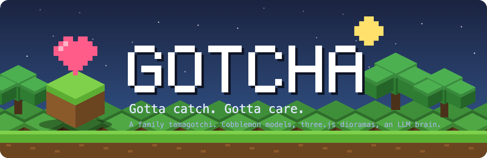
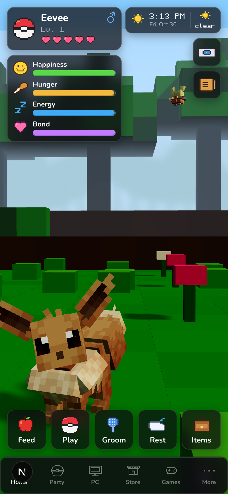
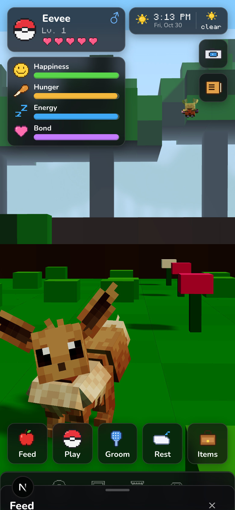
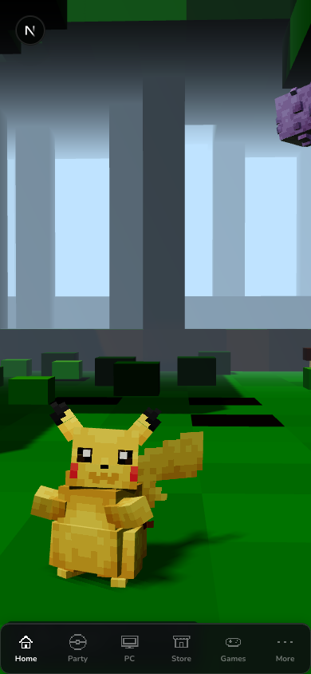
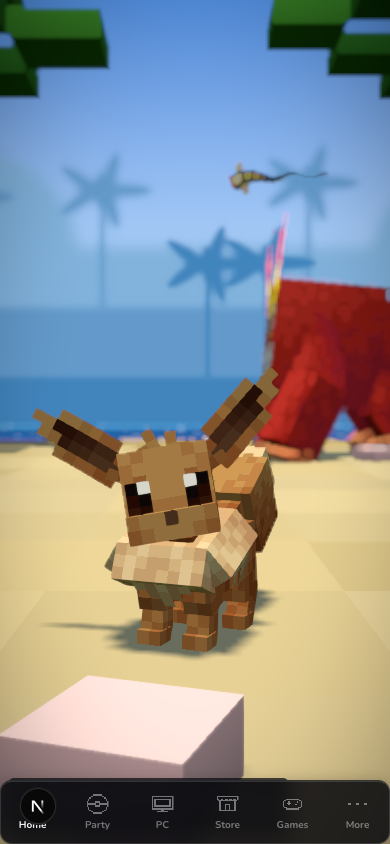
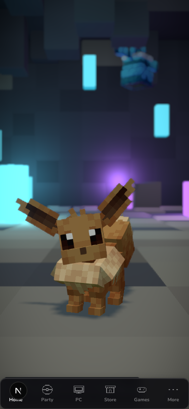

<p align="center">
  
</p>

<p align="center">
  <a href="docs/roadmap.md"></a>
  
  
  
  <a href="LICENSE"></a>
</p>

Gotcha is a tamagotchi for a family. Each trainer raises pokemon that live in
small Minecraft-style dioramas on their phone, rendered with three.js from the
Cobblemon mod's own models, animations and cries. The pokemon get hungry,
bored, tired and dirty on a clock. A language model decides what they do,
what they say when you talk to them, and what they remember about you. Every
pokemon can be exported as one `.cpkmn` file and traded to another install.

It is not a game you win. It is a creature you look after.

<p align="center">
  
  
  
  
  
</p>

<p align="center"><sub>The Home screen and Feed sheet, and three of the six dioramas, all rendered live from the Cobblemon assets.</sub></p>

## What you get

- **Real Cobblemon.** 903 species extracted from the mod jar: Bedrock geometry, animation clips, posers, textures, emissive layers and cries, rendered natively in three.js. Walking, swimming, flying and looking follow Cobblemon's own procedural animation calls.
- **Six dioramas.** Meadow, forest, beach, cave, snowfield and pond, built from a voxel block palette with a fixed low camera, day and night from the real clock, and ambient wild pokemon chosen from each biome's spawn list.
- **A simulation that does not cheat.** Six needs decay lazily from the last time anyone looked, in closed form, so a pokemon left for a week is exactly as hungry as it should be. Sickness comes from neglect, never dice. The engine is pure and fully tested, and the balance table is generated from it.
- **A brain with a rules floor.** NanoGPT picks what the pokemon does from a menu the engine already allowed, writes its one-line replies, and rolls each day into a journal. When the model is slow, over budget or absent, the rules take over and nothing stops.
- **Pokemon you can hold.** A `.cpkmn` file is a signed zip holding identity, stats, needs, personality, memories, history and optionally the assets. Importing sets the clock to now, so time in a file is stasis. Trades are locked on the sending install and verified against the receiving install's known keys.
- **A family, not an account.** Identity comes from the reverse proxy's `Remote-User` header. Each trainer has a party of six with one active pokemon and a PC with as many boxes as they need. Everyone sees everyone's active pokemon on the Neighborhood screen.
- **Bytes.** One currency, earned by care, milestones and mini-games on a diminishing daily curve, spent on berries, poffins, potions, toys, decorations and new dioramas. There is no way to buy Bytes.

See [docs/roadmap.md](docs/roadmap.md) for what is built and what is next.

## How it fits together

```
phone ──▶ Next.js 16 (one pod)
            ├── src/world          three.js dioramas, Bedrock loader, Molang, procedural layers
            ├── src/lib/sim        pure engine: decay, mood, care, growth, economy
            ├── src/lib/brain      NanoGPT ticks, conversation, roll-up, personality, budgets
            ├── src/lib/services   party, PC, care, store, transfer, scheduler, rollover
            ├── src/app/api        routes, server-sent events, asset route
            └── Postgres 16        trainers, pokemon (one jsonb column per .cpkmn member), events, ledger, trades

packages/cpkmn              the file format: spec, schema, pack, unpack, verify, migrate
packages/cobblemon-assets   streams the Cobblemon jar into a runtime cache
packages/pokedex            PokeAPI plus Cobblemon species data, evolution rules, habitats
```

The brain never writes a stat. The engine decides what is possible, the
model chooses among those options, and the engine applies the result. That
split is what keeps four trainers fair to each other and keeps the pokemon
alive when the subscription hiccups.

## Quick start

Prerequisites: Node 22 (pnpm fetches it for you), pnpm 10, Docker, and a
copy of the Cobblemon mod jar. Cobblemon's models, textures and sounds are
not in this repository and must not be committed; the extractor reads them
from the jar you supply.

```bash
git clone https://github.com/YourBr0ther/gotcha.git
cd gotcha
pnpm install
cp .env.example .env                       # fill in NANOGPT_API_KEY if you have one
mkdir -p assets/cobblemon
cp ~/Downloads/Cobblemon-fabric-1.8.4+1.21.1.jar assets/cobblemon/cobblemon.jar

pnpm db:up                                 # Postgres 16 in Docker on port 5434
pnpm db:migrate
pnpm assets:extract                        # about 10 seconds, writes .cobblemon-cache/
pnpm pokedex:build                         # about 9 minutes the first time, 1 second after
pnpm dev
```

Open http://localhost:3000 on a phone-sized window. In development the
`GOTCHA_DEV_USER` value in `.env` stands in for the proxy header; change it
to act as a second trainer.

Useful checks:

```bash
pnpm test              # the whole suite, needs the local Postgres
pnpm typecheck
pnpm lint
pnpm sim:balance       # regenerates docs/balance.md from the engine
pnpm assets:check eevee
pnpm brain:smoke       # one live NanoGPT call, to tell "key works" from "rules mode"
```

## Configuration

| Variable | Purpose |
|---|---|
| `DATABASE_URL` | Postgres connection string |
| `GOTCHA_DEV_USER` | Stands in for `Remote-User` outside production |
| `NANOGPT_API_KEY` | NanoGPT subscription key. Without it the brain runs by rules |
| `NANOGPT_BASE_URL` | Defaults to `https://nano-gpt.com/api/v1` |
| `GOTCHA_MODEL_TICK`, `GOTCHA_MODEL_TALK` | Models for decision ticks and conversation; both default to `zai-org/glm-5.2` |
| `GOTCHA_STT_URL`, `GOTCHA_STT_MODEL` | Speech to text endpoint, OpenAI style; the browser's own recognizer is tried first |
| `CPKMN_SIGNING_KEY`, `CPKMN_KEY_ID` | ed25519 key this install signs exports with (`pnpm tsx scripts/keygen.ts`) |
| `ROLLOVER_TOKEN` | Bearer token for the nightly rollover endpoint |
| `GOTCHA_DATA_DIR` | Where the extracted asset cache lives in production |
| `OPEN_METEO_LAT`, `OPEN_METEO_LON` | Optional. Real weather in the diorama from Open-Meteo |

Budgets, decay rates, prices and payouts live in `src/lib/sim/constants.ts`
and `src/lib/brain/constants.ts`. The generated [balance table](docs/balance.md)
shows what the current numbers mean in hours.

## The pokemon file

A `.cpkmn` is a zip whose first entry is a stored `mimetype`, so any tool can
recognise it, followed by a signed manifest of content hashes and one JSON
member per concern: identity, stats, state, personality, memories, pokedex
snapshot, inventory, history. Assets can be embedded or referenced by the
hash of the species folder in the extractor's index. The full contract is in
[docs/cpkmn-format.md](docs/cpkmn-format.md) and the schema in
[packages/cpkmn/schema/cpkmn.schema.json](packages/cpkmn/schema/cpkmn.schema.json).

## Deployment

Gotcha runs as one container plus Postgres. The image is a Next.js
standalone build; the Cobblemon jar is copied to the data volume once and
the pod extracts it on first start. Kubernetes manifests, a Dockerfile and
the exact commands are the last milestone on the roadmap. Identity is
expected from a forward-auth proxy such as Authelia setting `Remote-User`;
there is no login screen and nothing to configure for one.

## Project layout

| Path | What lives there |
|---|---|
| `docs/plans/` | The design and decision log. Read it before changing architecture |
| `docs/cpkmn-format.md`, `docs/brain.md`, `docs/balance.md` | The file format, the brain's prompts and budgets, the generated balance table |
| `.claude/agents/` | Specialist agent definitions that own each slice of the codebase |
| `branding/` | Icon and banner, generated by `node branding/generate.mjs` |
| `scripts/` | Key generation, balance table, brain smoke test |

## Licensing and credit

Gotcha's code is MIT licensed. It is a fan project, not affiliated with or
endorsed by Nintendo, Game Freak, The Pokémon Company, Mojang or the
Cobblemon team. Pokémon and Minecraft are trademarks of their owners.

[Cobblemon](https://cobblemon.com) is the source of every model, animation,
texture and cry. Its code and data are MPL 2.0; its art assets carry their
own license and are never distributed by this repository. Species facts come
from [PokeAPI](https://pokeapi.co). The Monocraft font is used under the SIL
Open Font License.
